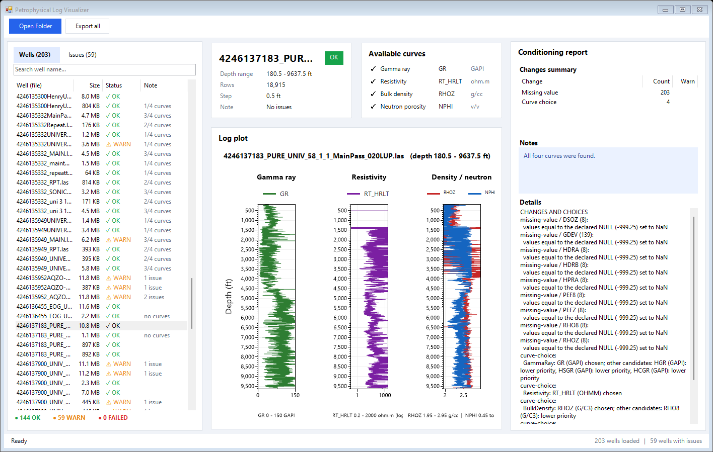
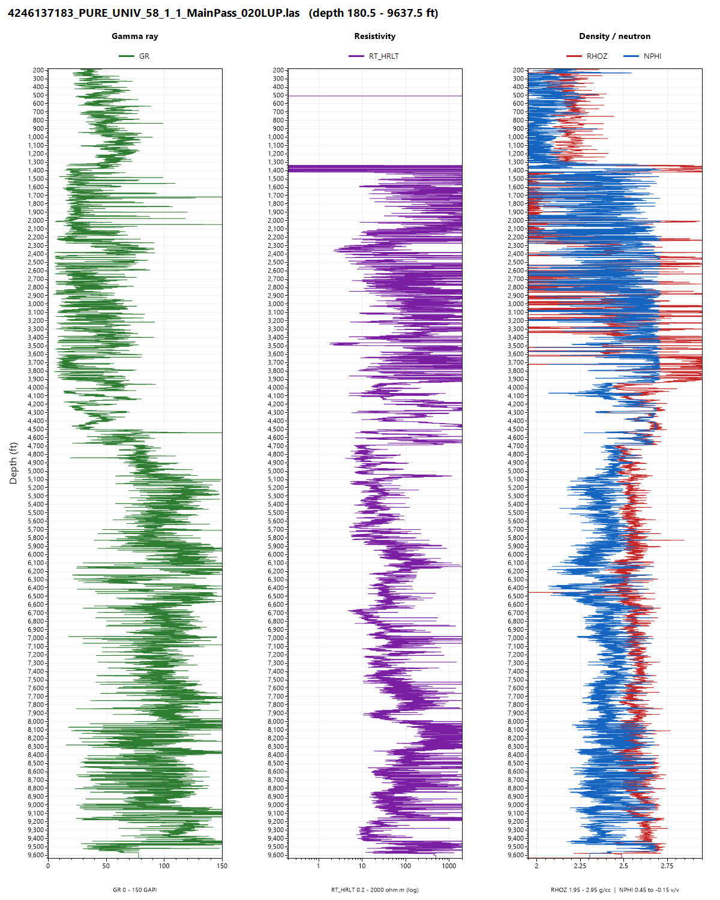

# Petrophysical Log Visualizer

Loads every LAS well-log file in a folder, cleans the data, reports every change, and draws a three-track log plot for each well. C#, .NET Framework 4.8, WinForms. The LAS reader is hand-written; ScottPlot is used only to draw.

The brief mentions 50 files; I received 203. The program handles all of them, and `deliverables/` holds the plots and reports for all 203.

| | |
|---|---|
| Input | a folder of `.las` / `.LAS` files |
| Output | `plots\<file>.png`, `load-report.csv`, `conditioning-report.csv`, `summary.md` |
| Result on the 203 files | all loaded, 0 failed, 203 plots |
| Tests | 157 xUnit tests |

## Example

The window with the 203 files loaded and one well selected:

One of the 203 plots.

## 1. Build and run

**Needs:** Windows, .NET Framework 4.8, Visual Studio 2022 (17.14 or newer) or 2026 with the ".NET desktop development" workload. Clone into a short path (e.g. `C:\src`), because some plot filenames in `deliverables/plots/` are long and Windows stops at 260 characters; a long path makes `git clone` fail with "Filename too long".

**Build** from the repository root (this also downloads ScottPlot and xUnit from NuGet):

    msbuild PetrophysicalLogVisualizer\PetrophysicalLogVisualizer.slnx -restore

or open the `.slnx` in Visual Studio and Build Solution. The program is `PetrophysicalLogVisualizer.App\bin\Debug\PetrophysicalLogVisualizer.App.exe` (add `-p:Configuration=Release` for Release). Tests: Test Explorer, or `vstest.console.exe` on `PetrophysicalLogVisualizer.Tests\bin\Debug\PetrophysicalLogVisualizer.Tests.dll`.

**Window** — run the exe with no arguments. *Open Folder* reads the files in the background and fills the list (file, size, status OK / WARN / FAILED, a short note such as `no curves` or `2/4 curves`). Click a well to see its plot, the curves found, and what was changed or warned about. *Export all* does the same as `--batch`. The plot is a picture: no zoom.

**Command line** — no window; used to produce the deliverables:

    PetrophysicalLogVisualizer.App.exe --batch <folder with .las files> <output folder>

- `load-report.csv`: one row per file (status, rows, curves, every problem found).
- `conditioning-report.csv`: one row per change or choice (file, `note`/`warn`, category, curve, count, detail). `summary.md` totals it; read it first.
- Sub-folders are not searched. Exit code 0 when the run finished, 2 when the folder does not exist.

## 2. Design

- **Core** (reader, rules, reports, plot model; no UI, references nothing), **App** (window, `--batch`, ScottPlot drawing), **Tests**.
- Each file goes through the same steps: `read → header → data table → missing values → depth unit → depth order → choose curves → reports → plot`.
- **Data model:** depth is a `double[]`, each curve a `float[]`; no object per row. A missing value is `NaN`; a row is never dropped because one curve is missing; nothing is interpolated.
- **Reader:** no LAS library; no LINQ or per-line `Split` in the data loop; invariant culture. A file that cannot be read is a result with a reason, never an exception.
- **Memory:** files are processed one at a time and each file's numbers are released once its plot and report entries exist, so memory follows the largest file, not the number of files. The cost: nothing keeps all wells' numbers in memory at once, and the window reloads a well when it is clicked.
- **Plot:** Core builds a model (what to draw, on which fixed scale), App draws it; the same code makes the PNG files and the window.
- Curve names and accepted units live only in `CurveRules.cs`. Every rule has a test, and every rule that came from the data has an entry (D-01 to D-24) in [docs/DATA_NOTES.md](docs/DATA_NOTES.md) with the file names and numbers behind it.

## 3. Data-conditioning decisions

Figures are from the 203 files. Details and evidence for each rule are in `docs/DATA_NOTES.md`.

| Area | What the program does | Why |
|---|---|---|
| Reading | Latin-1 text; decides from the data whether rows are wrapped; skips `#` lines in the data; stops at the next `~` section | no byte is lost; one file says `WRAP NO` but wraps rows (D-12); `#` lines shifted a depth column (D-22) |
| Bad numbers | `1.#INF`, `(null)`, `****` become `NaN` and are counted; short rows are padded with `NaN`, extra values reported | the rest of the row is still good (D-07, D-09) |
| Missing values | the declared NULL becomes `NaN` (not when NULL is 0, which is a warning); seven known undeclared markers too (`-999.25 -999 -9999 -99999 -9999.9999 -9999.999 -999.2`); no "below -90" rule | five files declare NULL 0; 29 files use markers they do not declare (D-04, D-16); real readings such as -270 exist |
| Depth | reverses a descending table (27 files); sorts a table that jumps back (1 file); keeps the first of equal depths (200 rows, 1 file); compares the real step with `STEP` and reports gaps; never resamples; metres to feet (tested, no file needed it) | D-13, D-14, D-15 |
| Curve names and units | picks gamma ray, resistivity, density and neutron by mnemonic **and** unit in a fixed priority; keeps the original name and lists the other candidates; neutron `%`/`PU` divided by 100; density `K/M3` divided by 1000; a count rate (`CPS`) is never a porosity; skips all-`NaN` candidates | the same measurement has many names and units (D-17 to D-20) |
| Plausibility | warns when the median gamma ray (1-500) or density (1.0-3.6 g/cc) is outside a wide range | two files have impossible values (D-23); the ranges are my estimate |
| Copies | a byte-identical copy is flagged `WARN` but still processed | 11 copies; nothing is dropped silently (D-24) |
| Plot | fixed scales: GR 0-150, resistivity 0.2-2000 (log), density 1.95-2.95 with neutron 0.45 to -0.15 on the same track; out-of-scale values are kept and run off the track | the standard way to read these logs (D-21) |

## 4. Performance and resource use

Release build, `--batch` over the 203 files (1,019.4 MB), Windows 11, Intel Core i5-12450H (12 threads), 15.7 GB RAM.

| | Result |
|---|---|
| Total time (load, condition, plot, write reports) | 43.0 s, 28.6 s, 31.4 s in three runs (23.7 to 35.6 MB/s) |
| Peak working set | 589 to 796 MB |
| Largest file alone (116.3 MB) | 2.3 s, peak 754 MB (about 6.5 times the file size) |
| A typical file (2.7 MB) | 0.3 s, peak 64 MB |
| Window: scan of all 203 files | 24 to 26 s; memory 441 to 521 MB after the scan |
| Window: click a well | plot after 0.1 s (typical file), 3.0 s (largest file) |

- Time varies a lot between runs of the same code (the first run was the slowest; I did not find out why). Read it as a range.
- It is single-threaded and CPU-bound, and time grows in proportion to the data: about 30 to 40 s per GB on this machine. Memory depends on the largest file, not on the number of files.
- Weak point: a file is read whole as text before it is parsed, so memory is about 6.5 times the largest file (a 1 GB file would need about 7 GB). Reading line by line instead saved only 3 % when I tried it, so I left it; the real fix is parsing while reading.
- After the window scans everything, memory stays at several hundred MB; I did not check whether that is memory not yet released or something kept by mistake.

## 5. Known limitations

- **Memory** is about 6.5 times the largest file (section 4); no parallelism.
- **Window:** the plot is a picture (no zoom, no hover); no data table, curve check boxes, menus or well details; tried on one screen at normal scaling only.
- **A file that loads but has none of the four curves** (mud logs, caliper-only) has status OK; the list says `no curves` and the reports say so. Making it a warning would change the reports and needs its own change and tests.
- **Plot:** one overview image per well (about 10 ft per pixel for a 14,000 ft well in the PNG); out-of-scale values run off the track unmarked; cased intervals give junk curves, shown as recorded; values at or below 0 are left out of the log track (counted on the plot).
- **Rules resting on little evidence:** the markers `-9999.999` and `-999.2` (one file each) and the percent-versus-fraction check; the plausibility ranges are my estimate and no petrophysicist has checked them; one file's columns probably do not follow its header (D-23), which the program can only warn about.
- **Not handled:** lines ending in CR only (reported FAILED); LAS 3.0 beyond its first data section; copies with a different header; several runs of one well are plotted as separate wells.

For thousands of wells I would parse while reading, run files in parallel with a memory limit, and draw one min/max pair per pixel row instead of every point.

## 6. How I used AI

**Background.** This is my first C# project and I had no petrophysics background. Before planning I read up on the basic terms (well log, LAS, curve, gamma ray, resistivity, density, neutron porosity) and on how a log is read, and compared stack options; the choice (WinForms, ScottPlot, .NET Framework 4.8) is explained in `PROJECT.md`.

**Models and workflow.** Claude Code throughout: Claude Opus 5.5 to plan `PROJECT.md` and `AGENTS.md` (the rules the coding agent follows: one small task at a time, report with real run output, never commit on its own); Claude Sonnet 5.5 (medium effort) to implement, task by task; Claude Opus 5.5 again for testing and checking. I also generated a mock-up of the window with ChatGPT from the information I had, and used it only as a visual reference.

| The AI | Me |
|---|---|
| wrote the reader, rules, reports, plots, window and tests, and scanned the 203 files into `docs/DATA_NOTES.md` | set the scope, plan and rules; approved every commit (nothing was committed without my "ok commit") |
| gave options with a recommendation | chose: which markers to accept, to keep out-of-scale values, to flag copies instead of skipping them, what the window should and should not have |

**What I did instead of reading every line.** I understand the concepts and the structure of the program, but not every detail of the C# syntax; where I did not, I asked the AI to explain it. What I put my effort into was a workflow that lets the work be checked and trusted:

- `AGENTS.md`: the rules the AI works under. One small task at a time; a report with real run output after each task; no new library or change of data structure without asking me; never a commit without my "ok commit"; one purpose per commit.
- `SSOT.md`: one status file (plan, current state, history), updated at the end of every task.
- A test for every rule, and every rule that came from the data is written down with its evidence in `docs/DATA_NOTES.md`.
- Small commits whose message says why, not only what.

## Project documents

| File | What is in it |
|---|---|
| `PROJECT.md` | scope, requirements, plan |
| `docs/DATA_NOTES.md` | what the files look like and the rule each finding led to |
| `AGENTS.md` | the rules I gave the AI |
| `SSOT.md` | status and history of the work, updated after every task |
